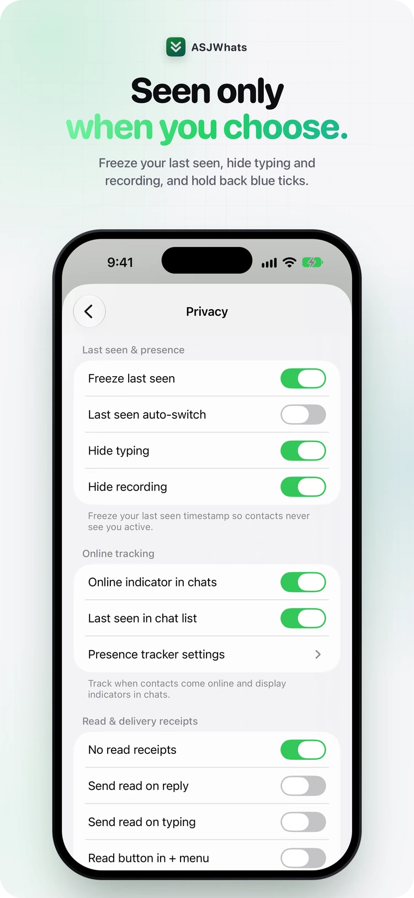
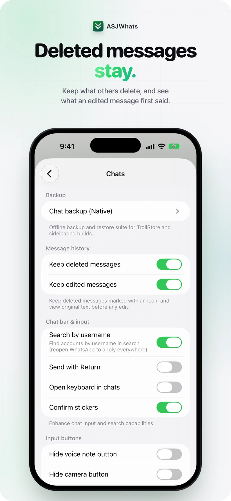
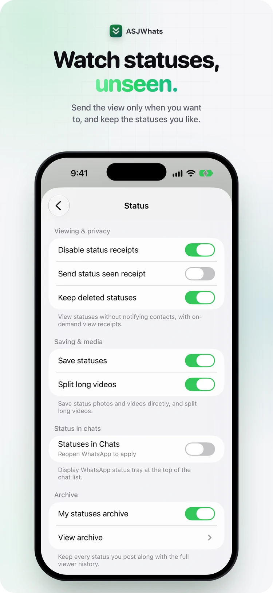
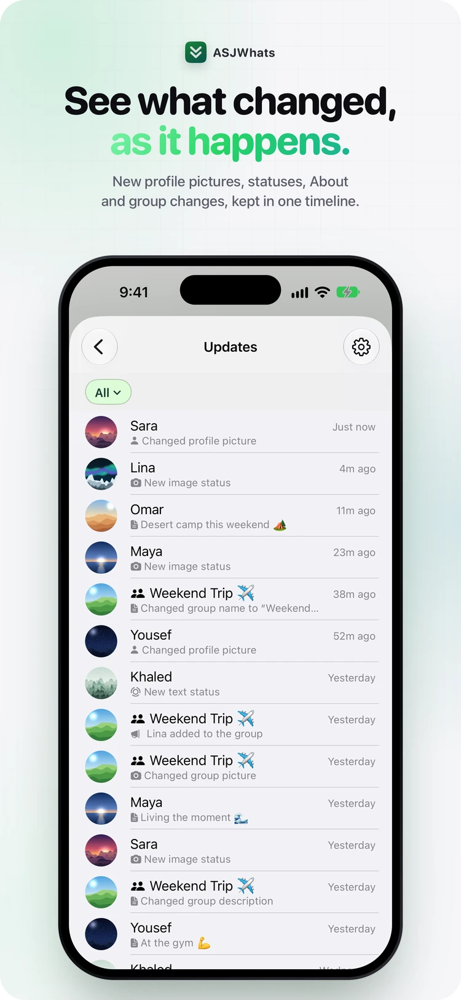
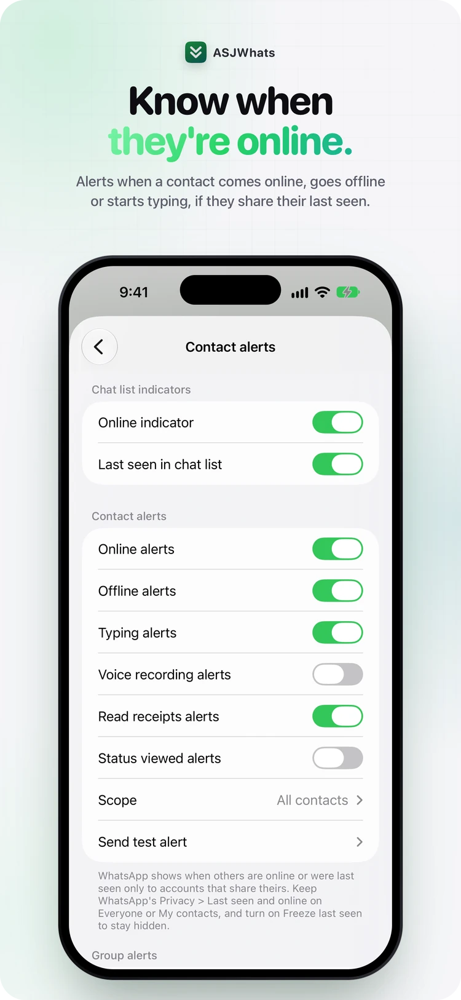
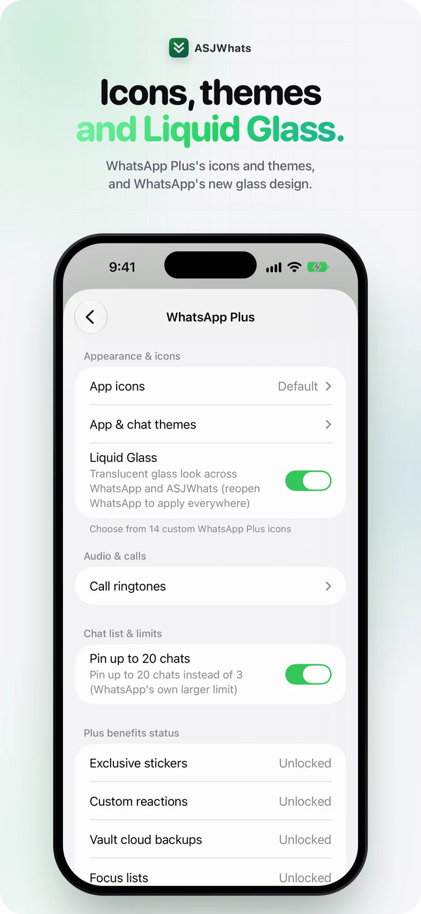
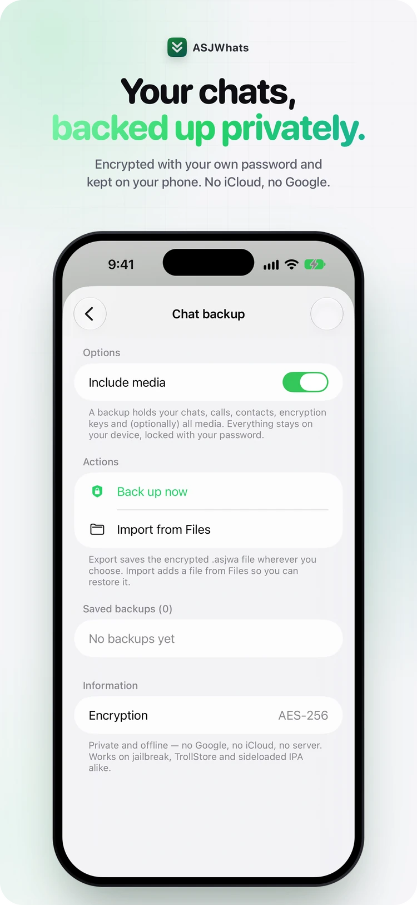
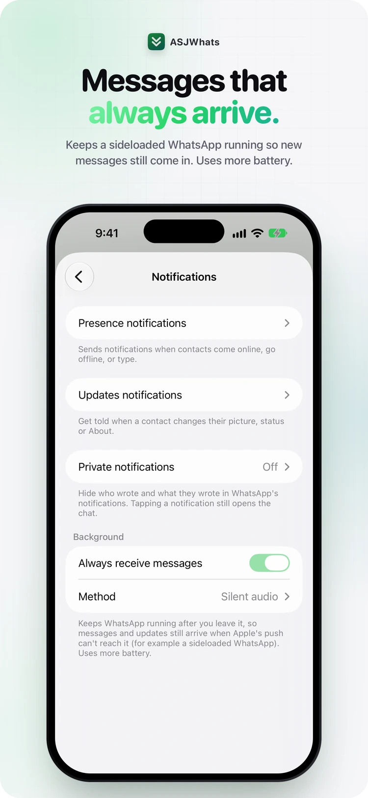

<div align="center">

<picture>
  <source media="(prefers-color-scheme: dark)" srcset="icon/icon-dark.png">
  
</picture>

# ASJWhats

**Privacy, statuses, backup and chat options for WhatsApp — without changing how the app looks.**

<sub>English and Arabic</sub>

Add the source in Sileo, Zebra, Cydia or Installer:

```
https://apt.ahmadrashed.com
```

Signing it yourself? `https://source.ahmadrashed.com` in ESign, Feather or KSign · `https://altstore.ahmadrashed.com` in AltStore or SideStore

[**ahmadrashed.com**](https://ahmadrashed.com) — the official website

[**ASJ Tweaks on Telegram**](https://t.me/ASJTweaks) — new tweaks and update notes

</div>

<p align="center">
  <picture><source media="(prefers-color-scheme: dark)" srcset="screenshots/1-privacy.webp"></picture>
  <picture><source media="(prefers-color-scheme: dark)" srcset="screenshots/2-deleted.webp"></picture>
  <picture><source media="(prefers-color-scheme: dark)" srcset="screenshots/3-status.webp"></picture>
  <picture><source media="(prefers-color-scheme: dark)" srcset="screenshots/4-updates.webp"></picture>
</p>
<p align="center">
  <picture><source media="(prefers-color-scheme: dark)" srcset="screenshots/5-online.webp"></picture>
  <picture><source media="(prefers-color-scheme: dark)" srcset="screenshots/6-plus.webp"></picture>
  <picture><source media="(prefers-color-scheme: dark)" srcset="screenshots/7-backup.webp"></picture>
  <picture><source media="(prefers-color-scheme: dark)" srcset="screenshots/8-notifications.webp"></picture>
</p>

---

## Where it lives

Its own **ASJWhats** row in WhatsApp's Settings, right under your profile, opens every option — with a search field that finds any of them, in English or Arabic. Next to it, **Updates** opens the timeline of what your contacts changed, and below them sit **Contact alerts**, **Contact tracking**, **Alerts log** and **Fake location**. An **Updates** button in the Chats tab shows how many are new.

Before you log in, a gear on WhatsApp's welcome screen opens the same settings.

---

## Features

### Privacy

- **Freeze last seen** — contacts never see you active
- **No blue ticks** — send them when you reply, when you type, or with a Read button
- Hide typing and recording, and turn off delivery receipts
- **View once, kept** — replay it, and screenshot or record it without alerting
- Privacy per contact, quick privacy controls, and a switch that cuts WhatsApp off the network

### Messages and calls

- **Keep deleted messages** — marked with an icon
- **See what an edited message first said**
- Forward to 20 chats, without the Forwarded label
- Pin up to 20 chats, and keep archived chats in the archive
- Message any number without saving it
- Block incoming calls from everyone or from the contacts you choose, and **record calls** on your phone only
- Confirm before calling, hide the call buttons, send with Return, tap to record voice notes

### Statuses and updates

- **Watch statuses unseen** — send the view only when you want to
- Save any status, and keep the ones that get deleted
- **Updates timeline** — new profile pictures, statuses, About and group changes, as they happen
- Every status you post kept, with its viewers
- Statuses at the top of Chats, and long videos split into parts for your status

### Contact alerts

- **Know when they're online** — an alert when a contact comes online, goes offline or starts typing
- **Contact tracking** — when they came online, when they left and how long they stayed
- Online dots in chats, and last seen in the chat list
- Every alert in one log
- For contacts who share their last seen

### Media

- **Always send HD** photos and videos
- Pick unlimited photos, and select all in a chat's media
- Save profile pictures, and export voice messages
- Longer GIFs, and a forward button in the media viewer
- **More in the + menu** — a screenshot of the whole chat, images and GIFs from the web, photos sent as documents

### Look

- **WhatsApp Plus** — 14 app icons, accent colours for the app and chats, and call ringtones
- **Liquid Glass** — WhatsApp's new glass design
- Small titles, no status bar, portrait only
- Hide tab badges, the Meta AI button and more
- Seconds on every time, and normal-size emoji

### Security and backup

- **App lock** with Face ID, Touch ID or passcode — for WhatsApp, archived chats and starred messages
- Lock any chat, and cover WhatsApp in the app switcher
- **Encrypted chat backup** — with your own password, kept on your phone. No iCloud, no Google

### Extras

- **Private notifications** — hide who wrote and what they wrote
- **Messages that always arrive** on a sideloaded WhatsApp
- **Fake location** — share any place you pick on the map
- Show a name and photo you choose for specific numbers, on your phone only
- **Search every option**, in English or Arabic
- English and Arabic — follows WhatsApp's own language

---

## Install

### Jailbroken

Add the source above, or download a package from [Releases](../../releases) and install it with Sileo, Zebra or Cydia.

| Jailbreak | Package |
|---|---|
| Dopamine / palera1n (rootless) | `ASJWhats` — `iphoneos-arm64` |
| checkra1n / unc0ver and similar (rootful) | `ASJWhats` — `iphoneos-arm` |
| roothide | `ASJWhats (roothide)` |

Sileo, Zebra and Cydia pick the right architecture on their own; roothide is a separate entry.

### TrollStore

Supported, with a build of its own that keeps WhatsApp's own entitlements and its app extensions — notifications, widgets, share sheet, Siri and screen broadcast.

**[ahmadrashed.com/trollstore/whatsapp](https://ahmadrashed.com/trollstore/whatsapp)** — iOS 15.1–16.6.1, and 17.0 on some devices.

One link: on an iPhone with TrollStore it hands the file straight over, anywhere else it just downloads.

### Not jailbroken, no TrollStore

Add `https://source.ahmadrashed.com` in ESign, Feather or KSign and install it from there — that source also has the full build, with WhatsApp's own extensions. In AltStore or SideStore, add `https://altstore.ahmadrashed.com`.

Or download the `.ipa` from [Releases](../../releases) and sign it with Sideloadly or ESign — or take the `.dylib` and inject it into your own copy of WhatsApp, then sign and install.

A signed copy does not get Apple's push notifications: ASJWhats keeps it running so new messages still arrive (**Settings › ASJWhats › Notifications**), which uses more battery.

> The dylib is self-contained and does not need Cydia Substrate, so any injector works.
> WhatsApp itself is not distributed here — bring your own copy.

---

## Notes

- arm64 and arm64e
- Ready for WhatsApp updates: an option a new WhatsApp no longer has is left out instead of crashing it, and three crashes in a row start WhatsApp in safe mode
- The pictures show ASJWhats' own screens, with made-up contacts

<div align="center"><sub>by <a href="https://ahmadrashed.com">Ahmad Rashed</a></sub></div>
